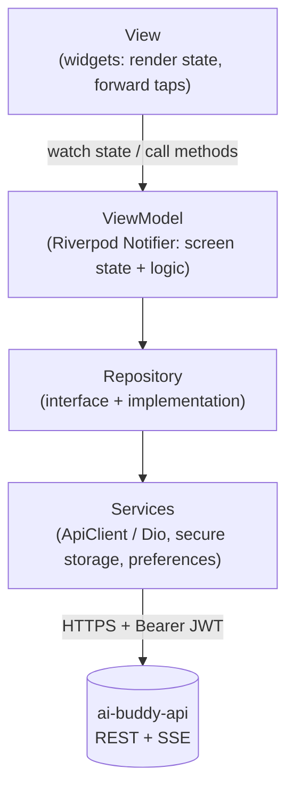

# AI Buddy: Flutter App

A ChatGPT-style AI chatbot app built with **Flutter**, **MVVM** and **Riverpod**.
Users sign up, chat with an AI assistant that streams its replies in real time,
and browse their conversation history.

The app talks only to its own backend, [**ai-buddy-api**](https://github.com/<your-username>/ai-buddy-api)
(Node.js + Express + MongoDB). The OpenAI key lives on the server and is
never shipped in the app.


---

## Contents

- [Features](#features)
- [Tech stack](#tech-stack)
- [Architecture](#architecture)
- [Project structure](#project-structure)
- [Getting started](#getting-started)
- [Running on a device](#running-on-a-device)
- [Testing](#testing)
- [Troubleshooting](#troubleshooting)
- [Roadmap](#roadmap)

## Features

**Authentication**
- Register and sign in, with client-side validation that matches the server's rules
- JWT stored in the Android Keystore / iOS Keychain (`flutter_secure_storage`)
- Automatic sign-in on launch; offline-safe (Retry instead of signing out)
- Automatic sign-out when the server rejects the token (expired or deleted account)

**Chat**
- Streaming replies with a typing indicator, rendered progressively
- Markdown rendering: headings, lists, tables, quotes, inline code
- Code blocks with language label, copy button and horizontal scrolling
- Stop generation mid-reply; Retry failed or stopped replies
- Copy any message; suggested prompts on an empty chat
- Auto-scroll that doesn't interrupt reading, with a "jump to latest" button
- Conversation history in a drawer (phones) or a side panel (tablets, 900 px or wider)

**App**
- Material 3 design system with light, dark and system themes (persisted)
- Profile and settings screens
- Consistent loading, empty, error and success states everywhere
- Global error handling with typed `AppException`s

> **Current status:** Phases 1–5 are complete. The chat runs on a **mock
> repository** that streams realistic replies. Phase 6 connects the real
> AI backend; only the repository changes. See the [roadmap](#roadmap).

## Tech stack

| Concern | Package |
|---|---|
| State management | `flutter_riverpod` 3 (Notifier / AsyncNotifier) |
| Navigation | `go_router` with an auth redirect guard |
| HTTP | `dio` with auth and logging interceptors |
| Models | `freezed` + `json_serializable` |
| Secure storage | `flutter_secure_storage` (JWT) |
| Preferences | `shared_preferences` (theme) |
| Markdown | `flutter_markdown_plus` |
| Testing | `flutter_test`, `mocktail` |

## Architecture

The app follows **MVVM**. Each layer only talks to the one below it.



| Layer | Responsibility | Rules |
|---|---|---|
| **View** | Screens and widgets | No business logic, no Dio, no storage |
| **ViewModel** | Screen state (immutable, Freezed) and actions | No `BuildContext`; unit-tested without widgets |
| **Repository** | One source of data per feature; maps errors to `AppException` | Abstract interface, so tests use fakes |
| **Service** | Raw I/O: HTTP, secure storage, preferences | No app logic |

### State management

| Need | Riverpod type | Example |
|---|---|---|
| Synchronous UI state | `Notifier` | `ThemeViewModel`, `ChatViewModel`, form ViewModels |
| Async state loaded on start | `AsyncNotifier` | `SessionViewModel` (restores sign-in), `ConversationsViewModel` |
| Screen-scoped work | `.autoDispose` providers | `LoginViewModel`, `HealthViewModel` |
| Dependencies | `Provider` | `apiClientProvider`, `authRepositoryProvider`, `chatRepositoryProvider` |

### Key design decisions

- **Session-driven routing.** GoRouter's `redirect` is a pure function of the
  session state (`resolveRedirect`), which makes it unit-tested and keeps
  screens free of navigation logic.
- **One error type.** Dio errors and the backend's `{ success:false, error:{…} }`
  envelope are mapped to a sealed `AppException` hierarchy in one place.
- **No circular providers.** The network layer reports a 401 through an
  `UnauthorizedSignal` that the session listens to.
- **Streaming that maps one-to-one to the backend.** `ChatStreamEvent`
  (`started`, `delta`, `completed`, `failed`) mirrors the server's SSE events.
  Streamed text is applied in 40 ms batches, so markdown doesn't re-render on
  every word.
- **Reversed message list.** Newest content stays in view while streaming,
  without manual scrolling.

## Project structure

```
lib/
├── main.dart                     # Bootstrap: error handlers, preferences, ProviderScope
├── app.dart                      # MaterialApp.router + theme
├── core/
│   ├── config/                   # Env (--dart-define), constants
│   ├── errors/                   # AppException, ErrorMapper, global handlers
│   ├── network/                  # ApiClient, endpoints, interceptors, providers
│   ├── router/                   # GoRouter + auth guard, route paths
│   ├── session/                  # SessionViewModel, SessionState, UnauthorizedSignal
│   ├── storage/                  # Secure token storage, preferences
│   ├── theme/                    # Design tokens, light/dark themes, palette extension
│   └── utils/                    # Validators, date labels, logger
├── shared/widgets/               # AppButton, AppTextField, state views, banners, …
└── features/
    ├── auth/                     # models, repository, ViewModels, splash/login/register
    ├── chat/                     # models, repositories (mock), ViewModels, chat UI widgets
    ├── profile/                  # profile screen
    ├── settings/                 # theme ViewModel, settings screen
    └── system/                   # health check, design-system showcase, 404
test/                             # mirrors lib/: unit, ViewModel, repository and widget tests
env/                              # API base URLs per environment (no secrets)
```

## Getting started

### Prerequisites

- Flutter **3.35** (Dart 3.9). This project uses [FVM](https://fvm.app), so
  prefix the commands with `fvm` if you use it too.
- Android Studio / Android SDK (emulator or a physical device)
- The backend running locally: see [ai-buddy-api](https://github.com/<your-username>/ai-buddy-api)

### Setup

```bash
git clone https://github.com/<your-username>/ai_buddy.git
cd ai_buddy
flutter pub get
dart run build_runner build --delete-conflicting-outputs   # Freezed / JSON code
```

### Configure the API address

The backend URL is passed at build time with `--dart-define-from-file`. No
secrets are compiled into the app.

| File | Use when | `API_BASE_URL` |
|---|---|---|
| `env/dev.json` | Android emulator | `http://10.0.2.2:4000/api` |
| `env/dev.usb.json` | Physical phone over USB (with `adb reverse`) | `http://localhost:4000/api` |
| `env/dev.device.json` | Physical phone over Wi-Fi | `http://<your-PC-LAN-IP>:4000/api` |
| `env/prod.json` | Release builds | your HTTPS API URL |

## Running on a device

Start the backend first (`npm run dev` in `ai-buddy-api`).

**Android emulator**

```bash
flutter run --dart-define-from-file=env/dev.json
```

**Physical phone over USB (recommended)**

```bash
adb reverse tcp:4000 tcp:4000       # repeat after reconnecting the phone
flutter run --dart-define-from-file=env/dev.usb.json
```

**Physical phone over Wi-Fi.** Put your PC's IP (`hostname -I`) in
`env/dev.device.json`, allow the port (`sudo ufw allow 4000/tcp`), then:

```bash
flutter run --dart-define-from-file=env/dev.device.json
```

**VS Code.** Add `.vscode/launch.json`:

```json
{
  "version": "0.2.0",
  "configurations": [
    {
      "name": "AI Buddy (USB phone)",
      "request": "launch",
      "type": "dart",
      "program": "lib/main.dart",
      "args": ["--dart-define-from-file=env/dev.usb.json"]
    }
  ]
}
```

> Plain HTTP is allowed only in **debug** builds (`android/app/src/debug/AndroidManifest.xml`).
> Release builds require HTTPS.

## Testing

```bash
flutter analyze        # static analysis (flutter_lints + stricter rules)
flutter test           # all unit and widget tests
```

| Area | What's covered |
|---|---|
| Core | Error mapping, `ApiClient` (stubbed HTTP), auth interceptor, router guard, session restore/sign-out/401 handling, validators, date labels |
| Auth | Repository (token storage, error codes), login/register ViewModels, full-app flows (boot, sign in, register, sign out) |
| Chat | Message parser, mock repository, `ChatViewModel` (send, stream, batching, stop, retry, interrupted streams, switching chats), chat screen widgets (welcome, prompts, code blocks, errors, Stop, drawer, wide layout) |
| Settings | Theme persistence |

Tests never call real servers: repositories are faked with `mocktail` or
in-memory fakes, and HTTP is stubbed at the Dio adapter.

## Troubleshooting

| Problem | Fix |
|---|---|
| `*.freezed.dart` / `*.g.dart` not found | `dart run build_runner build --delete-conflicting-outputs` |
| Requests hang on a **physical phone** | `10.0.2.2` only works in the emulator. Use `env/dev.usb.json` + `adb reverse tcp:4000 tcp:4000` |
| `CLEARTEXT communication not permitted` | Use a debug build, or HTTPS |
| "Unable to reach the server" | Is the backend running? Open `<API_BASE_URL>/health` in the phone's browser |
| `minSdkVersion` error | `android/app/build.gradle.kts` sets `minSdk` to at least 24 (required by `flutter_secure_storage`) |

## Roadmap

| Phase | Scope | Status |
|---|---|---|
| 1 | Architecture, API contracts, database design | ✅ |
| 2 | Flutter setup: MVVM, Riverpod, GoRouter, theme, Dio, storage, errors | ✅ |
| 3 | Backend setup (Express, MongoDB, security, logging) | ✅ |
| 4 | Authentication (register, login, auto-login, logout) | ✅ |
| 5 | Chat UI (streaming, markdown, code blocks, history, profile) | ✅ |
| 6 | Real AI via OpenAI + Server-Sent Events | ⏳ |
| 7 | Chat management: pagination, rename, delete, search | ⏳ |
| 8 | Database hardening: indexes, validation, pagination | ⏳ |
| 9 | Profile editing, clear history, app version | ⏳ |
| 10 | Full test suites | ⏳ |
| 11 | Deployment: MongoDB Atlas, HTTPS API, APK/AAB | ⏳ |
